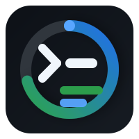

  

  

<h1 align="center">GitHub Copilot Usage</h1>

Expose remaining GitHub Copilot quotas as Home Assistant sensors.

## Features

- **Quota sensors:** Create a diagnostic sensor for each reported bucket, including premium interactions, chat and completions.
- **Usage details:** Report remaining percentage, entitlement, plan and quota reset date.
- **Polling:** Adjust the coordinator's scan interval in the integration options.
- **Authentication:** Use a personal access token; an experimental device-flow option requires your own GitHub OAuth app.

## Install

Use the Marketplace badge above on Home Assistant 2026.11 or later to add this
repository as a custom integration. On older versions, add it as a HACS
custom repository of type **Integration**. Install and restart Home Assistant.
The badge does not imply a public catalog listing. For manual installation,
copy `custom_components/github_copilot_usage` into Home Assistant's
`custom_components/` directory and restart.

## Quick start

1. Create a GitHub personal access token that can access your Copilot account.
2. Add **GitHub Copilot Usage** under **Settings → Devices & services → Add
   integration**, select personal access token authentication, and enter the
   token and an optional display name.
3. Inspect the remaining-quota sensors for the buckets returned by GitHub.

The integration polls GitHub's undocumented `copilot_internal/user` endpoint;
that endpoint may change. The experimental device flow requires a GitHub OAuth
app with device flow enabled, but its token may be rejected by this endpoint.
Personal access token authentication is the known-working path.

## License

[GPL-3.0](LICENSE). GitHub Copilot logos are GitHub-owned trademarks and are
not relicensed under this repository's license.
